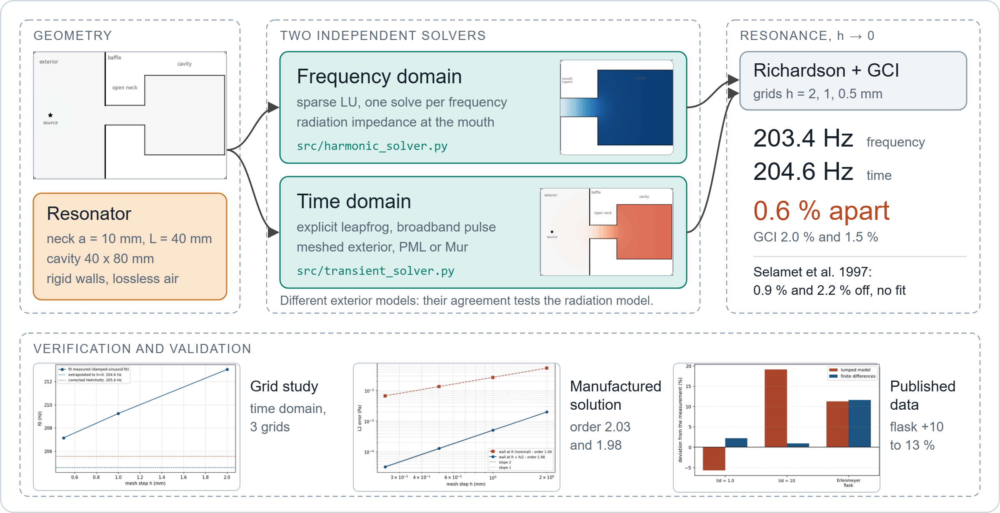

# Helmholtz resonator solver

[Preprint (PDF)](paper/main.pdf) · [Details](docs/details.md) · [Measurement protocol](experiments/protocol.md) · [Cite](CITATION.cff)



Two independent axisymmetric finite-difference solvers, one in the frequency domain and one in the time domain, predict the resonance of an open-neck Helmholtz resonator. After grid extrapolation they agree to 0.6 % (203.4 and 204.6 Hz, GCI 2.0 and 1.5 %), and they match two published resonators to 0.9 and 2.2 % with no fitted parameter.

## Method

The geometry is a neck of radius 10 mm and length 40 mm opening into a rigid baffle, on a cylindrical cavity of radius 40 mm and height 80 mm, with rigid walls and lossless air. Both solvers work on the meridian plane (r, z):

```math
\partial_t^2 p = c^2 \nabla^2 p + F, \qquad \nabla^2 p + k^2 p = -F .
```

- **Frequency domain** ([`src/harmonic_solver.py`](src/harmonic_solver.py)): sparse LU per frequency; the domain stops at the mouth, which carries the baffled-piston radiation impedance as a Robin condition.
- **Time domain** ([`src/transient_solver.py`](src/transient_solver.py)): explicit leapfrog with a meshed exterior and a sponge, Mur or PML outer boundary; f0 and Q come from a damped-sinusoid fit to the cavity ring-down.

Because the two model the exterior differently, their agreement tests the radiation model. Each is checked by a manufactured solution (observed order 2.03 and 1.98), then run on 2, 1 and 0.5 mm grids and extrapolated with Richardson and the GCI. Full formulation: [docs/details.md](docs/details.md).

This started in 2023 as my TIPE (the research project of the French classes préparatoires) and was rebuilt in 2026. All code, studies and the preprint are mine; the physics, the GCI method and the published measurements come from the papers in [`paper/references.bib`](paper/references.bib).

## Results

| Quantity | Value | Source |
|---|---|---|
| f0, time domain, h → 0 | 204.6 Hz (GCI 1.5 %) | `data/convergence_f0.npz` |
| f0, frequency domain, h → 0 | 203.4 Hz (GCI 2.0 %) | `data/fdm_sweep_h{2.0,1.0,0.5}.npz` |
| Lumped formula, ΔL = 0.85a + 0.66a | 205.6 Hz | `data/convergence_f0.npz` |
| Selamet et al. ([1997](https://doi.org/10.1121/1.417986)), two resonators | 2.2 % and 0.9 % off | [`notebooks/harmonic_study.ipynb`](notebooks/harmonic_study.ipynb) |
| Indenbom & Pogossian ([2023](https://doi.org/10.1051/aacus/2023039)), flask | +10 to +13 % | `data/literature_validation.npz` |

`python scripts/readme_numbers.py` recomputes these numbers from `data/`. The verification table (manufactured solutions, 0.25 mm control grid, outer-boundary reflection) is in [docs/details.md](docs/details.md#verification-table).


*Time-domain solver on a 1 mm grid: a broadband pulse enters the neck and the cavity keeps ringing at its own frequency.*

## Install and quick start

Tested on Windows 10, Python 3.11.9, NumPy 2.2.6, SciPy 1.15.2.

```bash
pip install -r requirements.txt
python verification/mms_transient.py                  # ~15 s, observed order 1.98
python scripts/readme_numbers.py                      # < 1 s, the numbers above
python studies/frequency_sweep.py                     # 1-1000 Hz sweep, ~77 s
python experiments/literature_validation.py           # ~4 min
```

The time-domain grid study and the other scripts are listed in [docs/details.md](docs/details.md#all-run-commands). They overwrite the committed files in `data/` and `figures/`.

## Code structure

| Path | Content |
|---|---|
| `src/` | the two solvers |
| `verification/` | manufactured solution, grid convergence, control grid |
| `studies/` | frequency sweep, outer boundaries, neural-basis test |
| `experiments/` | published-data comparison, ring-down analysis and protocol |
| `notebooks/` | frequency-domain and time-domain studies |
| `data/`, `figures/` | committed results and figures |
| `paper/` | preprint source and PDF |

## Limitations

- Both solvers are lossless, so Q is overpredicted (about 40 for the flask against 18 to 30 published).
- Cavities are cylinders; the flask, modeled as a cylinder of equal volume, stays 10 to 13 % high.
- The Selamet agreement uses a 1 mm grid and a pressure-release mouth, so part of it may be fortuitous.
- The time-domain radiation Q is not converged with exterior size, and the PML keeps a 4 % reflection on the curved boundary.
- No measurement of my own yet; the ring-down protocol has not been used on a real object.

## Citation and license

Cite with [`CITATION.cff`](CITATION.cff) or the preprint. MIT license, see [LICENSE](LICENSE).

Clément Dumeril · [clement.dumeril.net](https://clement.dumeril.net)
