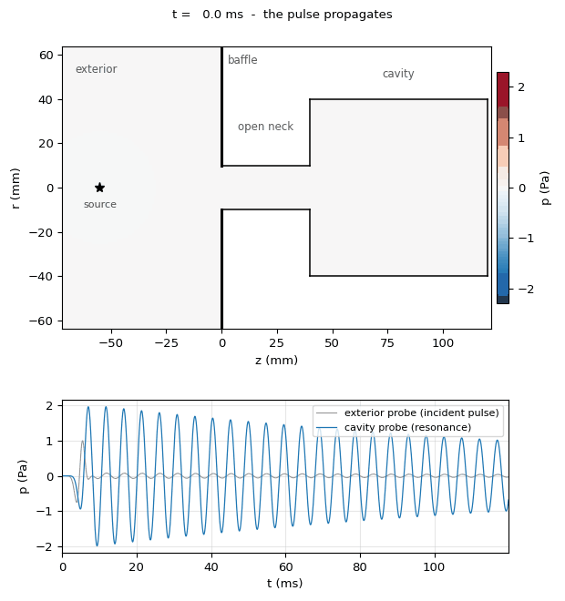
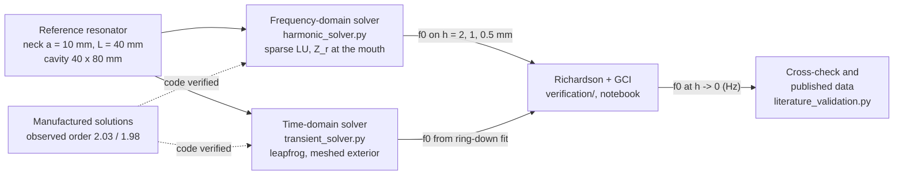
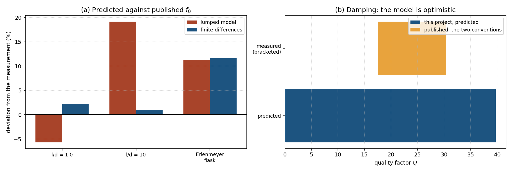

# Helmholtz resonator solver: two verified axisymmetric finite-difference solvers for an open-neck resonator

Two independent finite-difference solvers, one in the frequency domain and one in the time domain, predict the resonance of an open-neck Helmholtz resonator to within 0.6 % of each other after grid extrapolation (GCI 1.5 to 2.0 %), and match two published resonators to 0.9 and 2.2 %.

[Preprint (PDF)](paper/main.pdf) · [Details](docs/details.md) · [Measurement protocol](experiments/protocol.md) · [Cite](CITATION.cff)



*Time-domain solver on a 1 mm grid. A broadband pulse enters the neck and the cavity keeps ringing at its own frequency.*

## Overview

The project started in 2023 as my TIPE (the research project of the French classes préparatoires), and I rebuilt it in 2026. It also began as a PINN experiment. I dropped the network because I could not judge its output without a reference I trusted, so I wrote that reference instead: two solvers that model the exterior differently, so that their agreement tests the radiation model, plus a verification ladder from manufactured solutions to published measurements.

All code, studies and the preprint are mine. The physics (Helmholtz model, Rayleigh and Ingard end corrections, baffled-piston impedance), the GCI method, the PML and Mur conditions, and the measurements I compare with come from the literature cited in [`paper/references.bib`](paper/references.bib).



*Verification ladder and the file behind each step.*

## Formulation

**Geometry and medium.** Axisymmetric resonator: neck of radius a = 10 mm and length L = 40 mm opening at z = 0 into a rigid baffle, cylindrical cavity of radius 40 mm and height 80 mm. Rigid walls, lossless air, c = 343 m/s, ρ = 1.204 kg/m³.

**Equations.** On the meridian plane (r, z), time domain and frequency domain (k = ω/c):

```math
\partial_t^2 p = c^2 \nabla^2 p + F, \qquad \nabla^2 p + k^2 p = -F, \qquad \nabla^2 p = \partial_r^2 p + \tfrac{1}{r}\partial_r p + \partial_z^2 p .
```

On the axis, L'Hôpital's rule gives ∇²p = 2∂²p/∂r² + ∂²p/∂z². Rigid walls impose ∂p/∂n = 0.

**Frequency-domain solver** ([`src/harmonic_solver.py`](src/harmonic_solver.py)). Sparse complex assembly with one SciPy LU factorization per frequency. The domain stops at the mouth, which carries the low-frequency baffled-piston impedance Z_r = ρc[(ka)²/2 + i 8ka/(3π)] as a Robin condition. Walls are imposed by folding the ghost node onto the diagonal. A Gaussian volume source drives the cavity; f0 is the peak of the cavity pressure, located by a three-point parabola on a 0.05 Hz sweep.

**Time-domain solver** ([`src/transient_solver.py`](src/transient_solver.py)). Explicit leapfrog with Δt = 0.5 h / (c√2), masked finite-volume Laplacian, a meshed exterior of 120 x 100 mm behind a rigid baffle with 30 mm sponge layers, and a Ricker pulse centred at 250 Hz. f0 and Q come from a damped-sinusoid fit to the cavity probe for t ≥ 45 ms, over 250 ms of simulated time.

**Outer boundaries** ([`studies/radiation_boundaries.py`](studies/radiation_boundaries.py)). Sponge, first-order Mur, and an unsplit second-order PML (Cartesian stretch in (r, z), without the 1/r term of a cylindrical PML), all in one solver core.

**Grids.** Uniform h = 2, 1 and 0.5 mm, plus a 0.25 mm control grid for the frequency-domain solver.

## Results

| Quantity | Value | Source |
|---|---|---|
| f0, time domain, extrapolated to h → 0 | 204.6 Hz (order 0.86, GCI 1.5 %) | `data/convergence_f0.npz` ([`verification/grid_convergence.py`](verification/grid_convergence.py)) |
| f0, frequency domain, extrapolated to h → 0 | 203.4 Hz (order 0.94, GCI 2.0 %) | `data/fdm_sweep_h{2.0,1.0,0.5}.npz` ([`docs/details.md`](docs/details.md)) |
| Gap between the two solvers | 0.6 % | same files |
| Lumped formula, ΔL = 0.85a + 0.66a | 205.6 Hz | `data/convergence_f0.npz` |
| Selamet et al. ([1997](https://doi.org/10.1121/1.417986)), two side-branch resonators | 2.2 % and 0.9 % off, no fitted parameter (Dirichlet mouth, h = 1 mm) | [`notebooks/harmonic_study.ipynb`](notebooks/harmonic_study.ipynb), section 5 |
| Indenbom & Pogossian ([2023](https://doi.org/10.1051/aacus/2023039)), Erlenmeyer flask | +10 to +13 % (387 to 396 Hz vs 351 Hz) | `data/literature_validation.npz` |



*Left: deviation from published frequencies. Right: predicted Q for the flask (about 40) against the published 18 to 30.*

## Verification

| Check | Result | Source |
|---|---|---|
| Manufactured solution, frequency domain, h = 4 to 0.5 mm | observed order 2.03 | `data/mms_results.npz`, notebook section 3 |
| Manufactured solution, time domain, h = 2 to 0.25 mm | observed order 1.98 with the wall at R + h/2; 1.00 with the wall at R (error 27 times larger at 2 mm) | `data/mms_transient.npz` ([`verification/mms_transient.py`](verification/mms_transient.py)) |
| Control grid at 0.25 mm, frequency domain | the 1 / 0.5 / 0.25 mm triplet extrapolates to 203.52 Hz, 0.06 % from the three-grid value | `data/control_grid.npz` ([`verification/control_grid.py`](verification/control_grid.py)) |
| Outer-boundary reflection against a domain four times larger | sponge 44.4 %, Mur 5.6 %, PML 4.0 % after a σ scan | `data/pml_study.npz` |
| Ring-down estimator | self-test passes | [`experiments/ringdown_analysis.py`](experiments/ringdown_analysis.py) `--self-test` |

The manufactured-solution test exposed a half-cell wall bias. On the real geometry the staircase walls lower the observed order to about 0.9, so I only compare frequencies extrapolated to h → 0.

`python scripts/readme_numbers.py` recomputes the numbers in the two tables above from `data/`.

### Neural bases: a negative result

What is left of the PINN idea is a test with no trained network ([`studies/neural_basis_benchmark.py`](studies/neural_basis_benchmark.py)). I projected the 1 mm field onto tanh, SIREN, Gabor and domain-decomposition bases by least squares. They fit the field to 0.15 to 0.36 %, but the PDE residual of the fit is 2,536 to 9,979 times that of the zero field (`data/bench_bases.npz`).

## How to run

`pip install -r requirements.txt` (PyTorch only for the neural benchmark). Tested on Windows 10 with Python 3.11.9, NumPy 2.2.6 and SciPy 1.15.2 (November 2026: `mms_transient.py` reproduced the committed `data/mms_transient.npz`). Times are from my machine.

```bash
python verification/mms_transient.py                  # ~15 s, observed order 1.98
python experiments/ringdown_analysis.py --self-test   # ~15 s, prints "Self-test passed"
python scripts/readme_numbers.py                      # < 1 s
python studies/frequency_sweep.py                     # 1-1000 Hz sweep, ~77 s
python studies/neural_basis_benchmark.py              # ~1 min
python experiments/literature_validation.py           # ~4 min
jupyter lab notebooks/harmonic_study.ipynb            # frequency-domain MMS, GCI, Selamet
```

The time-domain grid convergence needs three solver runs first:

```bash
OR_TMS=250 OR_H=2   OR_TAG=_h2  python src/transient_solver.py
OR_TMS=250 OR_H=1               python src/transient_solver.py
OR_TMS=250 OR_H=0.5 OR_TAG=_h05 python src/transient_solver.py
python verification/grid_convergence.py
```

These scripts overwrite the committed files in `data/` and `figures/`.

## Reproducing figures

| Figure | Script |
|---|---|
| `figures/helmholtz_resonance.gif` | `tools/make_resonance_anim.py` (reads `data/open_resonator_anim.npz`, produced by `src/transient_solver.py` and not versioned) |
| `figures/literature_validation.png` | `experiments/literature_validation.py` |
| `figures/mms_transient.png`, `figures/convergence_f0.png` | `verification/mms_transient.py`, `verification/grid_convergence.py` |
| `figures/pml_study.png`, `figures/bench_bases.png`, `figures/fdm_sweep.png` | `studies/radiation_boundaries.py`, `studies/neural_basis_benchmark.py`, `studies/frequency_sweep.py` |
| `paper/figures/*.pdf`, `paper/numbers.tex` | `paper/make_figures.py` (called by `paper/build_paper.sh`) |

## Code structure

| Path | Content |
|---|---|
| `src/` | the two solvers |
| `verification/` | time-domain manufactured solution, grid convergence, 0.25 mm control grid |
| `studies/` | frequency sweep, outer-boundary comparison, neural-basis benchmark |
| `experiments/` | comparison with published data, ring-down analysis and protocol for a future measurement |
| `notebooks/` | frequency-domain study (MMS, GCI, Selamet) and time-domain study |
| `tools/` | animations and earlier figure scripts |
| `scripts/readme_numbers.py` | recomputes the README numbers from `data/` |
| `data/`, `figures/` | committed results and figures |
| `paper/` | preprint source, figure script, generated numbers, PDF |

## Limitations

- Both solvers are lossless, so Q is overpredicted (about 40 for the flask against 18 to 30 published).
- Cavities are cylinders. The flask, modeled as a cylinder of equal volume, stays at 387 to 396 Hz against 351 Hz measured.
- The agreement with Selamet uses a 1 mm grid and a Dirichlet mouth with no duct-side correction, so part of it may be fortuitous.
- The time-domain radiation Q is not converged with exterior size, and the PML keeps a 4 % reflection on the curved boundary.
- No measurement of my own yet; the ring-down protocol has not been used on a real object.

## Citation, license, credits

Cite with [`CITATION.cff`](CITATION.cff) or the preprint. MIT license, see [LICENSE](LICENSE). Built on NumPy, SciPy, Matplotlib and PyTorch.

Clément Dumeril · [clement.dumeril.net](https://clement.dumeril.net) · [github.com/clementdumeril](https://github.com/clementdumeril)
