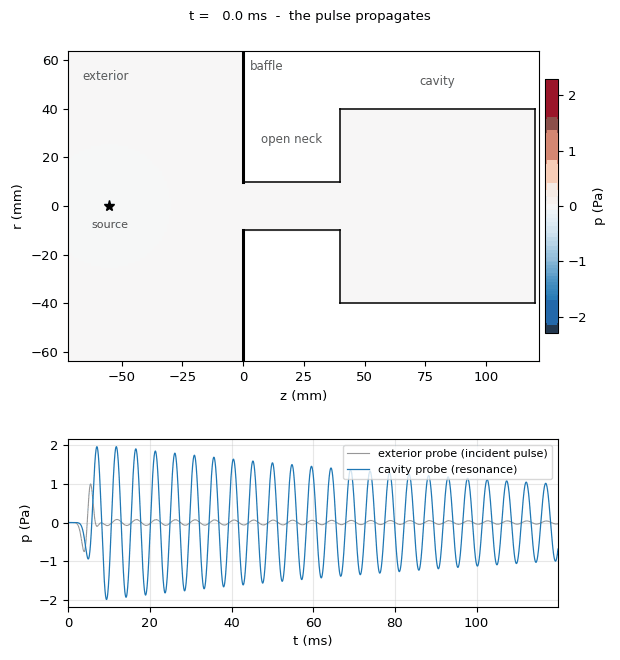
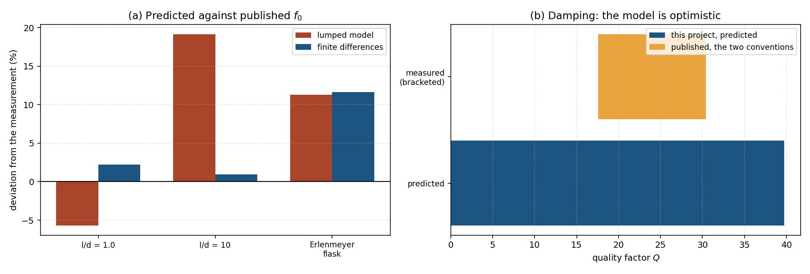
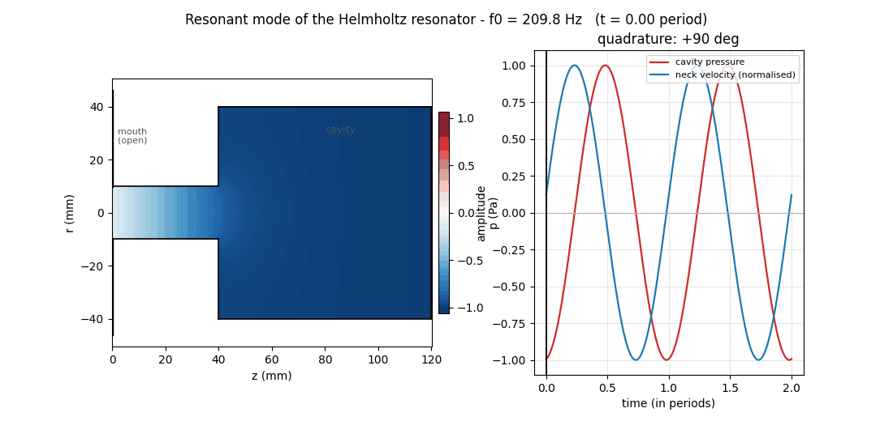
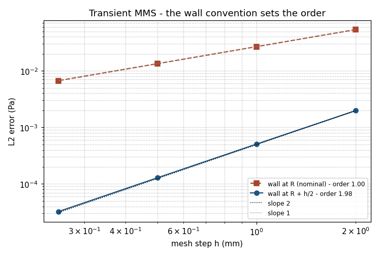
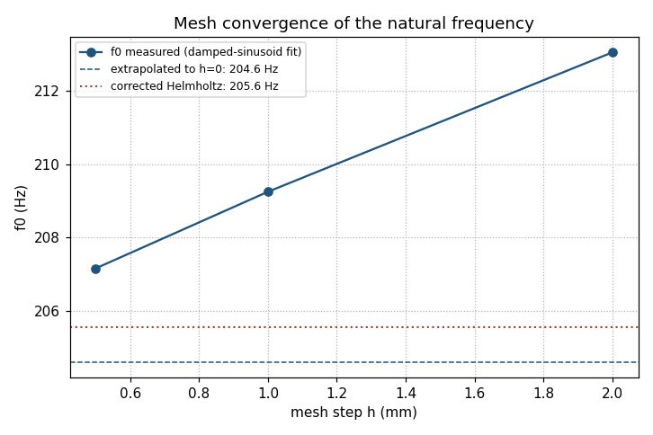
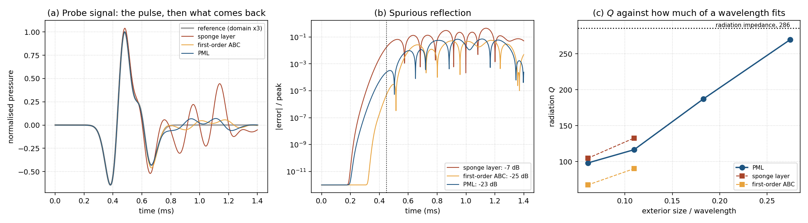
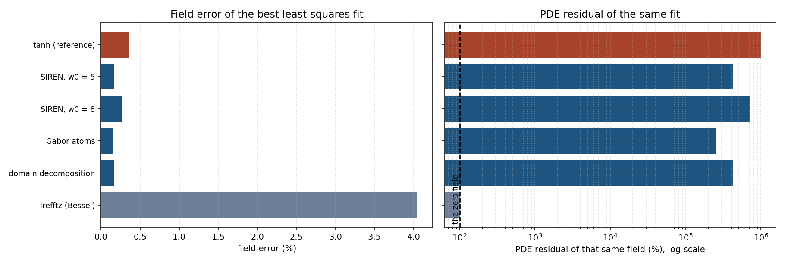

# Helmholtz resonator: two finite-difference solvers, verified and checked against published data

Two independent axisymmetric finite-difference solvers (frequency domain and time domain) for an open-neck Helmholtz resonator, verified by manufactured solutions and grid convergence, agreeing with each other to 0.6% and with published measurements to 0.9–2.2%.



*Time-domain solver, 1 mm grid, mirrored meridian section. A broadband pulse from the source (left) reaches the mouth and enters the neck. Once the pulse has passed, the cavity keeps oscillating on its own: nothing in the model imposes a frequency. The f0 printed in the title is a quick FFT over this short animation run (13 Hz bins); the converged value is 204.6 Hz.*

This started as my TIPE, the research project of the French classes préparatoires, in 2023. In 2026 I reopened it and rebuilt it properly. The repository began as a physics-informed neural network experiment, hence its old name (`PINN-Helmholtz`), but I could not judge a network's output without a reference I trusted, so I wrote and verified that reference first. The question became: can a finite-difference model predict the natural frequency of an open resonator with a stated numerical uncertainty, and where does it stop matching reality?

Reference geometry: neck radius 1 cm, neck length 4 cm, cylindrical cavity of radius 4 cm and height 8 cm, air at 20 °C.

## Results

| Quantity | Value | Where it comes from |
|---|---|---|
| f0, time-domain solver, extrapolated to h → 0 | 204.6 Hz, GCI 1.5% | [`verification/grid_convergence.py`](verification/grid_convergence.py) → `data/convergence_f0.npz` |
| f0, frequency-domain solver, extrapolated to h → 0 | 203.4 Hz, GCI 2.0% | 3-grid sweeps `data/fdm_sweep_h{2.0,1.0,0.5}.npz` (computation below) |
| Gap between the two solvers | 0.6% | inside both uncertainty bands |
| Lumped formula with end corrections 0.85a + 0.66a | 205.6 Hz | 0.47% from the time-domain result |
| Selamet et al. (1997), two published resonators | 0.9% and 2.2% off, no fitted parameter | [`notebooks/harmonic_study.ipynb`](notebooks/harmonic_study.ipynb), section 5 |
| Indenbom & Pogossian (2023), Erlenmeyer flask | missed by about 11% (387–396 Hz vs 351 Hz measured) | [`experiments/literature_validation.py`](experiments/literature_validation.py) |

The two GCI figures are different quantities. 1.5% is the grid uncertainty of the time-domain f0 on the reference geometry. "About 2%" is the frequency-domain uncertainty: 2.0% on the reference geometry, and 2.1% on average over the five neck lengths (2 to 6 cm) of the harmonic convergence study.



*Left: deviation from published resonance frequencies. Selamet's two resonators have the same 4500 cm³ cavity in two shapes. The lumped formula only sees the volume and returns 85.8 Hz for both (−5.7% and +19%); the 2D field recovers both. Neither model explains the flask. Right: the Q I predict for the flask (about 40) against the published half-width, shown as a range because the paper does not say whether it is measured at half amplitude or half power.*

## What I built

All the code in this repository is mine. The physics (Helmholtz's lumped model, Rayleigh and Ingard end corrections, the baffled-piston impedance), the GCI method (Roache), the PML (Bérenger) and the measurements I validate against come from the literature listed in Credits.

- [`src/harmonic_solver.py`](src/harmonic_solver.py): frequency-domain solver for ∇²p + k²p = −F on the (r, z) half-plane. Sparse complex assembly, rigid walls by folding the ghost node onto the diagonal, and a Robin condition at the mouth carrying the low-frequency radiation impedance of a baffled piston. One sparse solve per frequency, about 0.1 s on the 1 mm grid (4,961 nodes).
- [`src/transient_solver.py`](src/transient_solver.py): time-domain solver for ∂²p/∂t² = c²∇²p + F. Explicit leapfrog, axisymmetric Laplacian written in masked finite volumes, the neck open onto a meshed exterior half-space with a rigid baffle, and a broadband Ricker pulse fired from outside, so the resonator picks its own frequency.
- [`studies/radiation_boundaries.py`](studies/radiation_boundaries.py): three outer-boundary treatments in one solver, so they can be compared on equal terms: a sponge layer, a first-order Mur absorbing condition, and an unsplit second-order PML with two auxiliary fields.
- Verification: [`verification/mms_transient.py`](verification/mms_transient.py) (space-time manufactured solution), [`verification/grid_convergence.py`](verification/grid_convergence.py) (damped-sinusoid fit of the free decay, Richardson extrapolation, GCI), and the harmonic study in [`notebooks/harmonic_study.ipynb`](notebooks/harmonic_study.ipynb), which carries its own self-contained copy of the frequency-domain scheme with its MMS, GCI and Selamet runs.
- Validation: [`experiments/literature_validation.py`](experiments/literature_validation.py), and a ring-down measurement chain for a real bottle ([`experiments/protocol.md`](experiments/protocol.md), [`experiments/ringdown_analysis.py`](experiments/ringdown_analysis.py)) whose `--self-test` recovers synthetic decays to 0.007% on f0 and 4.4% on Q. The measurement itself has not been made.
- [`studies/neural_basis_benchmark.py`](studies/neural_basis_benchmark.py): a training-free test of neural bases against the verified field (end of "How I checked it").
- [`paper/paper.pdf`](paper/paper.pdf): write-up of the harmonic study, with the derivations, the scaling-law analysis and the loss model.

## How it works

A Helmholtz resonator is a mass on a spring: the plug of air in the neck oscillates against the compressibility of the air in the cavity, so f0 = (c/2π)·√(S / (V·(L + ΔL))). The end correction ΔL accounts for the air that moves with the plug just outside each end of the neck. It is usually assumed; here the solvers compute it.

Both solvers work on the meridian plane of the axisymmetric geometry. On the axis the term (1/r)·∂p/∂r is 0/0; by L'Hôpital's rule it becomes ∂²p/∂r², so the Laplacian there is 2∂²p/∂r² + ∂²p/∂z², and the radial part is discretised as 4(p₁ − p₀)/h².

The two solvers treat radiation differently, which is the point of having two. The frequency-domain solver stops at the mouth and replaces the exterior by an analytic impedance; the time-domain solver meshes the exterior and has to absorb the outgoing waves at its outer boundary.



*Frequency-domain solution near resonance (0.5 mm grid). Neck velocity and cavity pressure are in quadrature (+90.2° measured), the signature of a mass-spring system.*

## How I checked it

I followed the usual verification and validation order, because each step only means something if the previous one holds.

| Step | Question | Evidence |
|---|---|---|
| Code verification | Does the code solve the equations it claims to? | Manufactured solutions: observed order 2.03 (frequency domain, 4 grids) and 1.98 (time domain, 4 grids) |
| Solution verification | Is the grid fine enough? | Richardson extrapolation and GCI on 2 / 1 / 0.5 mm grids, plus a 0.25 mm control grid that moves the extrapolated f0 by 0.2–0.4% |
| Cross-check | Does an independent solver agree? | 203.4 Hz vs 204.6 Hz, with a different discretisation and a different radiation model |
| Validation | Does it match measurements? | Selamet et al. within 0.9% and 2.2%; one flask missed by 11% |

**The manufactured solution found a first-order bias.** Matching the manufactured solution to the nominal wall position gave order 1.00 instead of 2. The masked finite-volume scheme puts a rigid wall on the face of the last cell, half a cell beyond the last node, so the geometry actually simulated is R + h/2. Matched to R + h/2, the same test gives order 1.98 and errors 27 times smaller at h = 2 mm. The scheme was fine; the geometry carries an O(h) bias. From then on I only compared frequencies extrapolated to h → 0.



That decision mattered for the end correction. Identified from the raw 1 mm frequency, the meshed exterior gives ΔL = 1.29a, 15% short of the expected 1.51a, which would suggest the exterior mesh under-represents radiation. Identified from the extrapolated frequency it gives 1.56a, within 3%. The shortfall was the mesh bias.



*Time-domain f0 from a damped-sinusoid fit to the free decay, on three grids. Observed order 0.86 (the staircase walls pull it towards 1), extrapolated value 204.6 Hz, GCI 1.5%.*

<details>
<summary>How the frequency-domain number (203.4 Hz, GCI 2.0%) is computed</summary>

The three sweeps were run with `studies/frequency_sweep.py` over 195–220 Hz in 0.05 Hz steps, each peak located by a three-point parabola:

```python
import numpy as np
f2, f1, f05 = (float(np.load(f"data/fdm_sweep_h{h}.npz")["f_pk"]) for h in ("2.0", "1.0", "0.5"))
p = np.log((f2 - f1) / (f1 - f05)) / np.log(2)    # observed order: 0.94
f_ext = f05 + (f05 - f1) / (2**p - 1)             # 203.39 Hz
gci = 1.25 * abs(f1 - f05) / f05 / (2**p - 1)     # 2.0 %
```

Peaks: 215.74, 209.84 and 206.75 Hz. The gap to the time-domain 204.60 Hz is 0.59%.
</details>

**The frequency was easy to pin down; the damping was not.** Across sponge, ABC and PML the time-domain f0 changed by less than 0.5%, but with the sponge settings alone the radiation Q varied by a factor of six (44 to 267). To find out why, I put three outer boundaries in one solver and measured their spurious reflection against the same run on a domain three times larger, where nothing can come back within the time window.

| Outer boundary | Spurious reflection | Q drift when the exterior grows from 10 to 18 cm |
|---|---|---|
| sponge layer (what the solver used) | 44% | +26.8% |
| first-order Mur ABC | 5.6% | +33.5% |
| PML | 4.0% | −1.8% |

The sponge reflected 44% of the incident amplitude, which explained the factor of six. The PML reaches 0.09% (−61 dB) on the flat boundary but stays at 4.0% on the curved one, because I used the Cartesian complex stretch in (r, z) and left out the 1/r term of a true cylindrical PML. A stable Q between 10 and 18 cm was still not convergence: at 209 Hz the wavelength is 1.64 m, so the exterior was only 0.06 of a wavelength. Growing it to 0.27 wavelengths takes Q from 98 to 117, 187 and 270, heading for the 286 given by the analytic radiation impedance, while f0 stays within 0.1%.



*(a) Probe signal against the large-domain reference. (b) Error over time, drawn at the default layer strength (PML −23 dB); the 4.0% in the table is after scanning the PML strength. (c) Radiation Q against exterior size in wavelengths.*

**Validation.** Selamet's resonators are side branches on a duct, so their mouth is a pressure-release boundary rather than a radiating one; I ran them with that boundary in the harmonic notebook. For the Erlenmeyer flask, my lumped model reproduces the authors' 391 Hz to 0.1%, and the 2D solver stays at 387–396 Hz across every cavity aspect ratio I tried, against 351 Hz measured. Resolving the field near the neck does not close the gap. My cylindrical cavity cannot represent the flask's conical shoulder, which is the most likely missing piece, but I have not shown it.

### Neural bases: a measured negative result

With a verified field available, I tested the usual explanation for poor PINN results on wave problems (spectral bias, fixed with a better basis) without training anything. For each basis I computed the best least-squares projection of the verified field, then the PDE residual of that projection. tanh, SIREN, Gabor atoms and domain decomposition all represent the field to better than 0.4%, yet all leave a residual 2,500 to 10,000 times larger than that of the zero field. The basis changes the conditioning by about eleven orders of magnitude, but capacity is not the bottleneck: the solution sits on a near-cancellation between ∇²p and −k²p, and a 0.15% error on p is a large error on ∇²p. I did not go on to train a PINN on this problem.



<details>
<summary>Other results in the notebook and the paper</summary>

- Frequency sweep: 1,000 harmonic solves from 1 to 1000 Hz take 77 s. At a 1 Hz step the peak read 209.95 Hz and 6.62 kPa; at 0.005 Hz it is 209.84 Hz and 7.25 kPa, because the −3 dB bandwidth (0.73 Hz) is narrower than the first step.
- Scaling law over neck length: a power law and the effective-length model f0 = A/√(L + ΔL) are statistically indistinguishable on the extrapolated frequencies (ΔAICc 0.3 with 5 lengths, 1.8 with 12). I keep the physical model: A matches theory (48.25), ΔL ≈ 0.67a, and its leave-one-out error is 5 to 10 times smaller.
- End-correction decomposition: the radiation impedance shifts ΔL by 0.823a, against 8a/(3π) = 0.849a (3.1%). This is a consistency check, since that reactance is imposed.
- Losses: viscothermal friction in the neck gives Q ≈ 47; bulk absorption is negligible (Q ~ 10⁶).
</details>

## Limitations

- Both solvers are lossless. The viscothermal boundary layer in the neck (about 0.14 mm thick) is the dominant loss and is only estimated analytically, so damping predictions are optimistic: Q ≈ 40 predicted for the flask against 18–30 published.
- Walls are staircased on a Cartesian (r, z) grid, which is why the observed order on real geometries is about 0.9 rather than 2, and why the extrapolation step is needed.
- Cavities are cylinders. The flask is modelled as a cylinder of equal volume, the likely reason for the 11% miss.
- The PML has a 4% reflection floor on the curved boundary, and the largest exterior run (0.27 wavelengths, Q = 270 vs 286) is consistent with convergence but does not demonstrate it.
- No measurement of my own: validation relies on published data. The ring-down protocol and its analysis script are ready but unused.

## Reproduce

Python 3.10+, `pip install -r requirements.txt` (PyTorch is only needed for the neural benchmark; the CPU build is enough). Times are from my machine, CPU only.

```bash
python verification/mms_transient.py                  # transient MMS, orders 1.00 vs 1.98 (~15 s)
python experiments/ringdown_analysis.py --self-test   # ~5 s
python studies/frequency_sweep.py                     # 1-1000 Hz harmonic sweep (~77 s)
python experiments/literature_validation.py           # Selamet + flask (~4 min)
python studies/neural_basis_benchmark.py              # no training (~2 min)
PML_SKIP_C=1 python studies/radiation_boundaries.py   # outer boundaries, short form (part C takes hours)
jupyter lab notebooks/harmonic_study.ipynb            # harmonic MMS, GCI, Selamet, scaling law
```

Grid convergence of the time-domain solver needs three runs first. Only the 1 mm result is versioned, and the 0.5 mm run costs about eight times the 1 mm one:

```bash
OR_TMS=250 OR_H=2   OR_TAG=_h2  python src/transient_solver.py
OR_TMS=250 OR_H=1               python src/transient_solver.py
OR_TMS=250 OR_H=0.5 OR_TAG=_h05 python src/transient_solver.py
python verification/grid_convergence.py
```

The notebooks are committed with their outputs, so every figure can be read without running anything. `tools/` regenerates the animations and the paper figures; `latexmk -pdf paper/paper.tex` rebuilds the paper.

## Credits

Clément Dumeril ([clement.dumeril.net](https://clement.dumeril.net), [github.com/clementdumeril](https://github.com/clementdumeril)). MIT licence, see [LICENSE](LICENSE).

Theory and data: Helmholtz (1860), Rayleigh (1896), Crandall (1926), Ingard (1953), Morse & Ingard (1968), Bérenger (1994), Roache (1994, 1998), Selamet et al. (1997, J. Acoust. Soc. Am. 102(6)), Peters et al. (2003), Moloney (2004), Indenbom & Pogossian (2023, Acta Acustica 7, 30), and Mur's first-order absorbing boundary condition. Full entries in [`paper/references.bib`](paper/references.bib). Built on NumPy, SciPy, Matplotlib and PyTorch.
