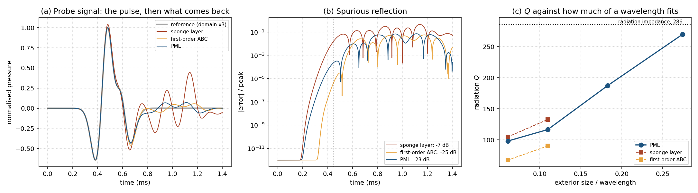

# Details

Supporting material for the [README](../README.md). The full report is [`paper/main.pdf`](../paper/main.pdf).

## Formulation

**Geometry and medium.** Axisymmetric resonator: neck of radius a = 10 mm and length L = 40 mm opening at z = 0 into a rigid baffle, cylindrical cavity of radius 40 mm and height 80 mm. Rigid walls, lossless air, c = 343 m/s, ρ = 1.204 kg/m³.

**Equations.** On the meridian plane (r, z), time domain and frequency domain (k = ω/c):

```math
\partial_t^2 p = c^2 \nabla^2 p + F, \qquad \nabla^2 p + k^2 p = -F, \qquad \nabla^2 p = \partial_r^2 p + \tfrac{1}{r}\partial_r p + \partial_z^2 p .
```

On the axis, L'Hôpital's rule gives ∇²p = 2∂²p/∂r² + ∂²p/∂z². Rigid walls impose ∂p/∂n = 0.

**Frequency-domain solver** ([`src/harmonic_solver.py`](../src/harmonic_solver.py)). Sparse complex assembly with one SciPy LU factorization per frequency. The domain stops at the mouth, which carries the low-frequency baffled-piston impedance Z_r = ρc[(ka)²/2 + i 8ka/(3π)] as a Robin condition. Walls are imposed by folding the ghost node onto the diagonal. A Gaussian volume source drives the cavity; f0 is the peak of the cavity pressure, located by a three-point parabola on a 0.05 Hz sweep.

**Time-domain solver** ([`src/transient_solver.py`](../src/transient_solver.py)). Explicit leapfrog with Δt = 0.5 h / (c√2), masked finite-volume Laplacian, a meshed exterior of 120 x 100 mm behind a rigid baffle with 30 mm sponge layers, and a Ricker pulse centred at 250 Hz. f0 and Q come from a damped-sinusoid fit to the cavity probe for t ≥ 45 ms, over 250 ms of simulated time.

**Outer boundaries** ([`studies/radiation_boundaries.py`](../studies/radiation_boundaries.py)). Sponge, first-order Mur, and an unsplit second-order PML (Cartesian stretch in (r, z), without the 1/r term of a cylindrical PML), all in one solver core.

Both solvers use uniform grids, h = 2, 1 and 0.5 mm, plus a 0.25 mm control grid for the frequency-domain solver.

## Verification table

| Check | Result | Source |
|---|---|---|
| Manufactured solution, frequency domain, h = 4 to 0.5 mm | observed order 2.03 | `data/mms_results.npz`, notebook section 3 |
| Manufactured solution, time domain, h = 2 to 0.25 mm | observed order 1.98 with the wall at R + h/2; 1.00 with the wall at R (error 27 times larger at 2 mm) | `data/mms_transient.npz` ([`verification/mms_transient.py`](../verification/mms_transient.py)) |
| Control grid at 0.25 mm, frequency domain | the 1 / 0.5 / 0.25 mm triplet extrapolates to 203.52 Hz, 0.06 % from the three-grid value | `data/control_grid.npz` ([`verification/control_grid.py`](../verification/control_grid.py)) |
| Outer-boundary reflection against a domain four times larger | sponge 44.4 %, Mur 5.6 %, PML 4.0 % after a σ scan | `data/pml_study.npz` |
| Ring-down estimator | self-test passes | [`experiments/ringdown_analysis.py`](../experiments/ringdown_analysis.py) `--self-test` |

The manufactured-solution test exposed a half-cell wall bias. On the real geometry the staircase walls lower the observed order to about 0.9, so I only compare frequencies extrapolated to h → 0.

`python scripts/readme_numbers.py` recomputes the numbers in the two tables above from `data/`.

## Neural bases: a negative result

What is left of the PINN idea is a test with no trained network ([`studies/neural_basis_benchmark.py`](../studies/neural_basis_benchmark.py)). I projected the 1 mm field onto tanh, SIREN, Gabor and domain-decomposition bases by least squares. They fit the field to 0.15 to 0.36 %, but the PDE residual of the fit is 2,536 to 9,979 times that of the zero field (`data/bench_bases.npz`).

## All run commands

`pip install -r requirements.txt` (PyTorch only for the neural benchmark). Tested on Windows 10 with Python 3.11.9, NumPy 2.2.6 and SciPy 1.15.2 (November 2026: `mms_transient.py` reproduced the committed `data/mms_transient.npz`). Times are from my machine.

```bash
python verification/mms_transient.py                  # ~15 s, observed order 1.98
python experiments/ringdown_analysis.py --self-test   # ~15 s, prints "Self-test passed"
python scripts/readme_numbers.py                      # < 1 s
python studies/frequency_sweep.py                     # 1-1000 Hz sweep, ~77 s
python studies/neural_basis_benchmark.py              # ~1 min
python experiments/literature_validation.py           # ~4 min
jupyter lab notebooks/harmonic_study.ipynb            # frequency-domain MMS, GCI, Selamet
```

The time-domain grid convergence needs three solver runs first:

```bash
OR_TMS=250 OR_H=2   OR_TAG=_h2  python src/transient_solver.py
OR_TMS=250 OR_H=1               python src/transient_solver.py
OR_TMS=250 OR_H=0.5 OR_TAG=_h05 python src/transient_solver.py
python verification/grid_convergence.py
```

These scripts overwrite the committed files in `data/` and `figures/`.

## Reproducing figures

| Figure | Script |
|---|---|
| `figures/helmholtz_resonance.gif` | `tools/make_resonance_anim.py` (reads `data/open_resonator_anim.npz`, produced by `src/transient_solver.py` and not versioned) |
| `figures/literature_validation.png` | `experiments/literature_validation.py` |
| `figures/mms_transient.png`, `figures/convergence_f0.png` | `verification/mms_transient.py`, `verification/grid_convergence.py` |
| `figures/pml_study.png`, `figures/bench_bases.png`, `figures/fdm_sweep.png` | `studies/radiation_boundaries.py`, `studies/neural_basis_benchmark.py`, `studies/frequency_sweep.py` |
| `paper/figures/*.pdf`, `paper/numbers.tex` | `paper/make_figures.py` (called by `paper/build_paper.sh`) |

## Axis treatment

Both solvers work on the meridian plane (r, z). On the axis, (1/r)·∂p/∂r is 0/0 and becomes ∂²p/∂r² by L'Hôpital's rule, so the Laplacian there is 2∂²p/∂r² + ∂²p/∂z². Its radial part is discretized as 4(p₁ − p₀)/h².

## Frequency-domain f0 extrapolated to zero mesh (203.4 Hz, GCI 2.0%)

Sweeps with `studies/frequency_sweep.py` over 195–220 Hz in 0.05 Hz steps on 2, 1 and 0.5 mm grids, each peak located by a three-point parabola:

```python
import numpy as np
f2, f1, f05 = (float(np.load(f"data/fdm_sweep_h{h}.npz")["f_pk"]) for h in ("2.0", "1.0", "0.5"))
p = np.log((f2 - f1) / (f1 - f05)) / np.log(2)    # observed order: 0.94
f_ext = f05 + (f05 - f1) / (2**p - 1)             # 203.39 Hz
gci = 1.25 * abs(f1 - f05) / f05 / (2**p - 1)     # 2.0 %
```

Peaks: 215.74, 209.84 and 206.75 Hz. The time-domain solver extrapolates to 204.60 Hz (observed order 0.86, GCI 1.5%), a gap of 0.59%.

A fourth grid at 0.25 mm (`verification/control_grid.py`) puts the peak at 205.18 Hz. The 1 / 0.5 / 0.25 mm triplet extrapolates to 203.52 Hz, 0.06% from the three-grid value. The time-domain extrapolation still rests on three grids.

## Outer-boundary study

Source: [`studies/radiation_boundaries.py`](../studies/radiation_boundaries.py), data in `data/pml_study.npz`.

With the original sponge layer, the time-domain radiation Q ranged from 44 to 267 depending on numerical settings. I measured three terminations against the same run on a domain four times larger:

- sponge layer: 44% reflection, which explains the spread in Q;
- first-order Mur: 5.6%;
- PML (unsplit, second order): 4.0% after tuning σ.

The PML reaches 0.093% on the flat boundary but stays at 4.0% on the curved one, because I used the Cartesian stretch in (r, z) without the 1/r term of a cylindrical PML.

With only the depth changing (10 to 18 cm, radius 12 cm), the PML Q moves by −1.8% and f0 spreads by 0.46% across the three treatments. Growing the whole exterior:

| Depth | Radius | Depth in wavelengths | Radiation Q | f0 (Hz) |
|---|---|---|---|---|
| 10 cm | 12 cm | 0.061 | 98.1 | 208.32 |
| 18 cm | 14.4 cm | 0.110 | 116.6 | 208.42 |
| 30 cm | 24 cm | 0.183 | 187.2 | 208.53 |
| 45 cm | 36 cm | 0.274 | 269.6 | 208.49 |

Q climbs toward the 285.6 of the frequency-domain solver while f0 stays within 0.1%. This is consistent with convergence but does not demonstrate it.



*(a) Probe signal against the large-domain reference (the legend says ×3; the reference domain is four times larger). (b) Error over time. (c) Radiation Q against exterior size in wavelengths.*

## Validation cases

Source: [`experiments/literature_validation.py`](../experiments/literature_validation.py) and section 5 of [`notebooks/harmonic_study.ipynb`](../notebooks/harmonic_study.ipynb).

Selamet et al. (1997) measured cylindrical resonators as side branches on a duct, so the mouth is modeled as a pressure-release boundary. At h = 1 mm: 93.0 Hz against 91 Hz (2.2%) and 72.7 Hz against 72 Hz (0.9%), with no fitted parameter.

Indenbom & Pogossian (2023) measured a 100 mL Erlenmeyer flask at 351 Hz. My solver, with the flask replaced by a cylinder of equal volume, gives 387–396 Hz for every aspect ratio tried. The gap matches an effective neck of about 54 mm instead of 43 mm, which would fit a neck flaring into a conical shoulder that my cylinder can't represent. For damping, the same paper gives Q between 18 and 30 and I predict about 40, which is optimistic, as Moloney (2004) also reports.

## Other results from the harmonic notebook

- A 1–1000 Hz sweep (1,000 solves) takes 77 s. The −3 dB bandwidth is 0.73 Hz, so the peak needs a finer step than 1 Hz.
- Over neck length, the model f0 = A/√(L + ΔL) fits as well as a power law, with A matching the theoretical 48.25 m^1/2/s and ΔL ≈ 0.67a.
- Viscothermal friction in the neck gives Q ≈ 47; bulk absorption is negligible.
